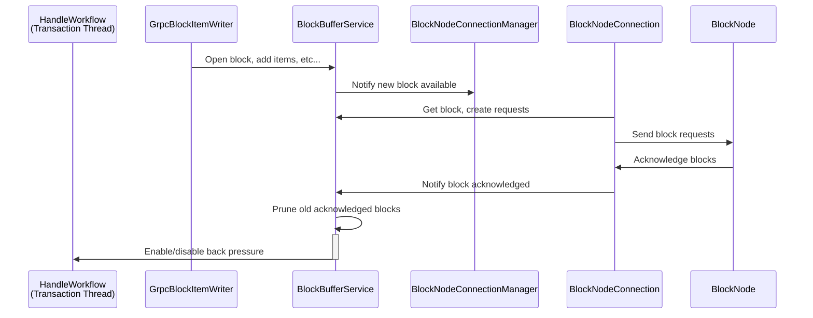

# BlockBufferService.md

## Table of Contents

1. [Abstract](#abstract)
2. [Component Responsibilities](#component-responsibilities)
3. [State Management and Flow](#state-management-and-flow)
4. [Component Interaction](#component-interaction)
5. [Sequence Diagrams](#sequence-diagrams)
6. [Error Handling](#error-handling)

## Abstract

The `BlockBufferService` is responsible for maintaining the most recent blocks, along with their items and requests,
produced by a given consensus node in an ordered manner.

## Component Responsibilities

- Keeps a recent history of blocks produced by the consensus node.
- Tracks which blocks are currently being produced and what the latest (or highest) block acknowledged by the block node.
- Provides an interface for access any block that is held in the buffer.
- Regularly prunes the buffer to reclaim memory by removing acknowledged blocks once they fall outside the soft
  retention floor (`blockStream.buffer.ackedBlocksToRetain`), with the hard `blockStream.buffer.maxBlocks` and
  `blockStream.buffer.maxBytes` ceilings always taking precedence when unacknowledged blocks push the buffer toward capacity.
- Monitors the buffer for saturation (i.e. too many blocks unacknowledged) and applies back pressure if necessary.
- Persists the buffer to disk for recovery purposes (only when `streamMode` is `BLOCKS`).

## State Management and Flow

- Updates stream progress on receipt of new blocks or acknowledgments.
- Implements backpressure and flow control logic to handle varying network conditions.
- Maintains an internal buffer of blocks with timestamps for acknowledgment tracking.
- Periodically prunes acknowledged blocks exceeding the TTL to maintain buffer size and resource efficiency.
- Calculates buffer saturation as a percentage of ideal max buffer size derived from TTL and block period.
- Activates or deactivates backpressure based on saturation status, coordinating with blocking futures to manage flow control.

## Component Interaction

- New blocks and their items are received from `GrpcBlockItemWriter`.
- `BlockNodeConnection` makes calls to retrieve blocks from the buffer for streaming.
- `BlockNodeConnection` notifies the `BlockBufferService` when a block is acknowledged by the block node.
- Applies back pressure via `HandleWorkflow`.

## Backpressure Mechanism

The block stream system implements a backpressure mechanism to ensure that block nodes keep pace with the incoming block stream.
If block acknowledgments are delayed beyond a configurable threshold, this mechanism activates to halt further block production
and transaction handling on the consensus node. This ensures system stability and prevents the accumulation of
unacknowledged blocks in the stream buffer.

### Buffer Management

The system maintains a buffer of block states in `BlockBufferService` with the following characteristics:

- Each block state contains the block items for a specific block number.
- The buffer tracks acknowledgment status as a single high watermark.
- Entries remain in the buffer until acknowledged.
- A periodic pruning mechanism removes acknowledged entries.

One or more unique acknowledgements may be required before a block is truly considered acknowledged and eligible for
pruning. A unique acknowledgement is defined as an acknowledgement received from a unique block node. If multiple
acknowledgements are received for the same block from the same block node, they are treated as one acknowledgement.
To change the number of required unique acknowledgements, you can update the application property
`blockStream.buffer.minAcksRequiredPerBlock`.

Within the block buffer, there are two capacity limits that are enforced:
- Max number of unacknowledged blocks - governed by `blockStream.buffer.maxBlocks`.
- Max number of bytes consumed by the buffer for unacknowledge blocks - governed by `blockStream.buffer.maxBytes`.
- Max number of in-progress blocks - governed by `blockStream.buffer.maxInProgressBlocks`.

When the pruner runs, it will first check if there are any acknowledged blocks that can be pruned. Once this is complete,
the number of unacknowledged blocks and the total bytes consumed by unacknowledged blocks is calculated. (Note: in-progress
blocks - i.e. blocks that haven't been closed yet - are not considered unacknowledged and thus don't count towards the
calculations.) If either of these exceeds the maximum permitted, then back pressure will be engaged. The effective
buffer saturation is the maximum of the two dimensions.

If the buffer is not saturated with unacknowledged blocks, then the buffer may retain acknowledged blocks. The number of
acknowledged blocks to retain is determined by the `blockStream.buffer.ackedBlocksToRetain` configuration. However, this
is overruled if the buffer starts to be become saturated with unacknowledged blocks. This feature is only a best-effort.

### Buffer Saturation

A common term used when talking about the block buffer is "saturation". In this context, saturation is the ratio of
incomplete or unacknowledged blocks/bytes that reside in the buffer versus some configured maximum. When "saturation is
increasing" it means that the buffer contains a growing number of unacknowledged blocks. When the buffer becomes
saturated, it means the buffer has exhausted its capacity for holding unacknowledged blocks, at which point back
pressure may be engaged.

There are currently three distinct facets, or inputs, that contribute to buffer saturation:
- Number of unacknowledged blocks as a simple count of blocks relative to the maximum number of blocks permitted, which
is governed by the application property: `blockStream.buffer.maxBlocks`.
- Number of bytes consumed by unacknowledged blocks relative to the maximum bytes permitted, which is governed by the
application property: `blockStream.buffer.maxBytes`.
- Number of in-progress blocks as a simple count of blocks relative to the maximum in-progress blocks permitted, which
is governed by the application property: `blockStream.buffer.maxInProgressBlocks`.

If either of these facets grows above a certain threshold, then the buffer may reach what's called the action stage.
The action stage is a state where the buffer is unhealthy and thus proactive measures should be taken - if possible - to
remediate the buffer issues. For example, if the buffer reaches the action stage due to too many unacknowledged blocks,
then the consensus node may attempt to switch to a different block node to get acknowledgements faster. If these
proactive measures do not help alleviate the issue, then the situation may worsen until the buffer becomes fully
saturated. At this point of full saturation, the buffer can apply back pressure and begin to halt the processing of new
transactions and building new blocks. Once back pressure is engaged, the consensus node continuously checks the buffer
for recovery. Once the buffer has recovered to a sufficient level, controlled by the application property
`blockStream.buffer.recoveryThreshold`, the consensus node will exit back pressure and start allowing transactions and
blocks again.

Not all sources of back pressure, or buffer unhealthiness in general, are responded to in the same manner. For example,
if the source of the issue is a lack of acknowledgements, then the consensus may switch to different block nodes.
However, if the source of the issue is too many in-progress blocks, switching block nodes will serve no purpose. In such
a case, there may not be any action the buffer or its downstream related components can do. (Too many in-progress blocks
may be a symptom of slow consensus or slow transaction processing and thus migrating to a different block node will have
no effect.)

### Backpressure Implementation

The backpressure mechanism operates at two levels:

1. **Block State Buffer Level**
   - An asynchronous thread is continuously running in the background to prune the buffer.
   - Pruning occurs on a configurable interval defined in `blockStream.buffer.pruneInterval` (if set to `0`, the pruning is disabled)
   - If buffer size exceeds safe thresholds after pruning, backpressure is applied
2. **HandleWorkflow Level**
   - `HandleWorkflow` checks for backpressure signals before processing each round of transactions
   - When backpressure is active, block production and transaction handling are paused
   - Processing resumes only after back pressure is removed (i.e. once blocks in the buffer are being acknowledged in
     a timely manner)

### Backpressure Flow

1. **Monitoring Phase**
   - `BlockBufferService` tracks buffer size and block age
   - Periodic pruning task runs based on `blockStream.buffer.pruneInterval`
   - Buffer metrics are updated for monitoring purposes
2. **Triggering Phase**
   - Backpressure triggers when:
     - Acknowledgments do not arrive within the configured TTL
     - Buffer size grows beyond safe threshold due to unacknowledged or delayed block responses
     - Pruning cannot reduce buffer size sufficiently
     - Block nodes fall significantly behind in processing
3. **Application Phase**
   - `HandleWorkflow` receives backpressure signal
   - Block production and transaction processing pauses
   - Streaming continues for already generated blocks to allow block nodes to catch up
   - Buffer gradually reduces as blocks are acknowledged
4. **Recovery Phase**
   - Buffer saturation recovers as more blocks are acknowledged
   - Once buffer reaches safe levels, backpressure releases
     - The 'recovery threshold' is configured by the property `blockStream.buffer.recoveryThreshold`. This value represents
       the saturation level at which the buffer is considered sufficiently free to accept more blocks. For example, if
       this value is 60%, then the buffer must be at or below 60% saturation before back pressure is removed.
   - Transaction processing resumes

### Block Buffer Persistence

Since the block buffer is a memory-based data structure, when an application restart happens the buffer gets reset to an
empty state. For most use cases this is OK, but if a block node requests a recent block the consensus node may not be
able to provide it. Because of this, there are two "recovery" mechanisms in place: 1) pre-consensus event stream (PCES)
replay and 2) block buffer persistence.

At any given time the platform keeps a set of events since the last saved state called the pre-consensus event stream or
PCES. The PCES data gets reset upon each state save operation, which typically occurs every 15 minutes. If the
application crashes, upon startup the PCES files will be automatically read and subsequent blocks will be re-built.
However, given that a block in the buffer has a lifespan of 5 minutes (configurable), if the application crashes within
five minutes of the last state save, then the PCES files will not contain information to build blocks from before the
state save. This would mean that upon restart only a partial set of the blocks that would have been in the buffer will
be re-created.

To address this issue, a secondary mechanism is in place: persisting the buffer itself. Upon being notified a state save
has occurred, all the blocks in the buffer will be written to disk, regardless of if some may be covered by PCES replay.
Upon startup of the block buffer service, an attempt will be made to load the most recent blocks from disk.

**Note:** Block buffer persistence only occurs when `blockStream.streamMode` is set to `BLOCKS`. When streaming in
`RECORDS` mode, the buffer is not persisted to disk.

## Sequence Diagrams

