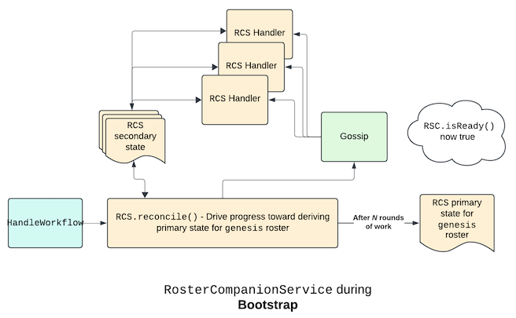
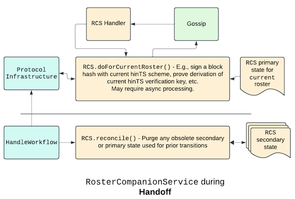
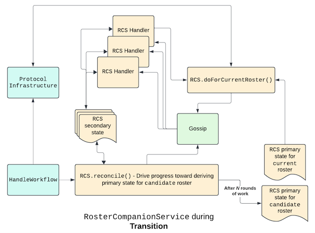

## Exact-weight TSS

A **threshold signature scheme (TSS)** lets a group of parties collectively sign a message by aggregating their
partial signatures. The **access structure** of a TSS is the set of subsets of the parties whose partial signatures
can be combined to form a valid signature. For an aBFT proof-of-stake blockchain, the ideal access structure at any
point in the protocol includes any set of nodes holding at least 1/3 of the total consensus weight. In a Hiero network,
consensus weights are the whole number of HBARs staked to each node, and hence require 64-bit precision since each
network has a fixed supply of 50B HBAR.

Ignoring the amount of work and party interactions required of a verifier, it is relatively straightforward to design
such a TSS. It is much harder to design an **efficient** TSS with this property. Efficiency demands,
- A stable, succinct **ledger identity** that verifiers can trust during any period since adoption of the TSS in which
the network's aBFT properties are not compromised; no matter how many nodes are added or removed, or change their
signing keys.
- **Concise signatures** whose length is independent of the size of the network.
- **Fixed-cost, non-interactive verification** that is again independent of the size of the network.

Hiero uses an efficient exact-weight TSS where signing works via the **hinTS** scheme published in [1], and the
ledger's identity is the hash of the ids, weights, and Schnorr public keys of the permissioned nodes in the network
at the time the TSS was adopted, concatenated with the hash of the hinTS verification key those nodes first used.

This document provides the high-level design of how Hiero TSS is implemented.

### Relation to the `RosterService` lifecycle

Since the very identity of the ledger in Hiero TSS depends on the ids, weights, and Schnorr keys of the nodes in
the network roster at the time of adoption, the TSS implementation is naturally guided by the lifecycle of the
`RosterService`. This lifecycle has three phases:
1. **Bootstrap**: Only a genesis roster exists, and although the nodes have secure communication channels,
there is no consensus state with the Schnorr or hinTS public keys of the nodes. In this phase, the TSS system must
derive this state from gossip, finish hinTS preprocessing, and establish the ledger id from the genesis WRAPS
address book and the initial hinTS verification key. Verifiers obtain this ledger id from a trusted source.
2. **Transition**: The current roster is fully active. Its WRAPS proof authenticates the current address book
and hinTS verification key. There is also a candidate roster that reflects the latest dynamic address book
changes and HBAR stake adjustments. The TSS system repeats hinTS preprocessing for the candidate roster and
uses the current roster's Schnorr signatures to extend the proof to the candidate address book and verification key.
3. **Handoff**: The current roster is fully active, but there is no candidate roster because the network has just
replaced its current roster with the candidate roster. In this phase, the TSS system may, for example, purge any
obsolete state accumulated during its previous transition phases; but it has no urgent responsibilities besides, of
course, providing ledger signatures.

### The `RosterCompanionService` abstraction

We structure the TSS system as two services with distinct responsibilities:
1. The `HintsService`, which implements the six main hinTS algorithms that function given the **common reference
string (CRS)** grounding the protocol; that is, preprocessing, key generation, hint generation, partial signing,
partial verification, and signature aggregation.
2. The `HistoryService` uses a recursive SNARK to prove that an address book (node ids, weights, and Schnorr keys)
and its metadata derive from the ledger id. Each transition requires signatures from a strict majority of the
source book's effective Schnorr weight.

For each roster, the WRAPS proof authenticates the serialized hinTS verification key as its metadata.
The standard block-proof verifier requires signer weight strictly greater than half the total encoded in that key.
History-backed keys preprocessed with TSS 3.29.1 include the full generation's listed roster weight.
Older sparse keys encode the participating parties' weight.

(Note the full message that nodes sign with their Schnorr keys in each `HistoryService` proof is the concatenation of
the hash of a canonical serialization of the list of `(node id, weight, Schnorr key)` triples defining the next roster
with the hash of the above metadata.)

Despite their separate responsibilities, both the `HintsService` and `HistoryService` share a high-level design that
we call the `RosterCompanionService`. This abstraction is a service whose goal is to derive some **primary state** for
each roster used by the `RosterService`, and that progresses, round by round, toward this goal by a **reconciliation
loop** driven by the `HandleWorkflow`. It uses whatever **secondary state** it needs and gossips any
**node transactions** required to implement this reconciliation loop.

A `RosterCompanionService` is **ready** when it has derived its primary state for the current roster. Becoming ready is
the prime objective of any `RosterCompanionService` during the bootstrap phase.



Completing bootstrap is equivalent to starting in a handoff phase, where a `RosterCompanionService` (`RCS`) has no
primary state to derive. Its only required function is to do **roster-scoped work** for the current roster on behalf of
other protocol infrastructure components; though it may also use the reconciliation loop to purge obsolete state.



At distinguished points (e.g., at a stake period boundary), the Hiero protocol creates a candidate roster that reflects
dynamic address book changes and HBAR stake adjustments. This initiates a transition phase, where the `RCS` must use the
reconciliation loop to derive its primary state for the candidate roster, at the same time it is doing tasks scoped to
the current roster.



#### A note on performance

In the first release of Hiero TSS, revisions to the candidate roster only happened at consensus midnight; and roster
handoffs only happened at upgrade boundaries scheduled 12 or more hours after UTC midnight. So new nodes after a handoff
had an entire release to successfully gossip their hinTS and Schnorr keys; and there were many hours between the latest
revision to the candidate roster and the next handoff to complete the work for each transition.

If Hiero networks move to a much more compressed schedule for roster revisions and transitions, `RCS` implementations
may want to do some transition phase work preemptively, even before the next revision to the candidate roster.For
example,
- A node new to the network could estimate the size of the next candidate roster and preemptively publish its hinTS
key for that size.
- A node new to the network could immediately publish its Schnorr key when going `ACTIVE`.

But these optimizations were not necessary in the first release of Hiero TSS.

### The `HintsService` as a `RosterCompanionService`

We first map the `HintsService` to the `RCS` abstraction. Its **primary state** for each roster is a
**hinTS construction** with everything needed for deterministic progress toward the hinTS scheme for that roster.
The main features of a hinTS construction are items such as,
1. A unique numeric id $c$ for the construction to help connect related hinTS state like votes to the construction.
2. The source roster hash.
3. The target roster hash (needed by a reconnecting node to recover weight information for nodes, and hence parties,
in the ongoing construction).
4. If the construction is complete, the hinTS aggregation and verification keys for the scheme.
5. If the construction is complete, the final mapping of node ids to hinTS party ids in the target roster.
6. If the construction is still collecting hinTS keys, the consensus time for the next aggregation attempt (an
**attempt** is a deterministic point in consensus time at which honest nodes pause and evaluate if they have enough
hinTS keys to satisfy the weight inequalities discussed in the [section](#implied-limitations-on-the-transition-phase)
below and begin the hinTS preprocessing algorithm).
7. If the construction has stopped accepting hinTS keys, the adoption time of the last accepted hinTS key.

Note that despite the strong functional analogy between the constructions that make up the roster-scoped primary state
for the `HintsService` and `HistoryService`, they have quite distinct goal states and need not have a one-to-one
correspondence. In particular, even if the Hiero signing mechanism were to change from hinTS to something else, this
would not require any change to the structure of a `HistoryService` proof construction.

The `HintsService` **secondary state** is everything else needed to facilitate deterministic progress on a
construction; in particular, for nodes that reconnect during the construction. Main types of secondary state are
items such as,
1. _Per construction size `M = 2^k`_ : For as many parties as possible, for a party with id $i \in [0, M)$, the
party's hinTS key; the node id that submitted that hinTS key; the consensus time the hinTS key was adopted in the
ongoing construction; and, if applicable, a revised hinTS key the same node wishes to use in subsequent constructions
of size $M$. (A node operator might wish to rotate their key for security reasons and trigger such a revision.)
Note that a node's assigned party id for a particular construction size never changes; so this implies such secondary
state is fully purged before reusing a party id for a new node id.
2. _Per construction id `c`_ : For a subset of node ids $\{ i_1, \ldots, i_n \}$ in the source roster of
construction $c$ accounting for at least 1/3 of its weight, their consensus vote for a particular preprocessing
output with aggregation and verification keys for construction $c$.

The **reconciliation loop** of the `HintsService` evolves this secondary state by a combination of scheduling
expensive cryptographic operations to run off the `handleTransaction` thread, and gossiping the results of these
operations (or votes on those results) to other nodes. These node operations likely include,
1. `HintsKeyPublication` - a transaction publishing the node's hinTS key for a particular construction size for
use in the next construction of that size (or an ongoing construction of that size, if this is the first such
publication for the node). In general, storing node's hinTS keys for multiple party sizes may lead to some mild
duplication of information about the node's public BLS key; but this will be rounding error compared to the size of
the hints, which are proportional to the number of parties.
2. `HintsPreprocessingVote` - a transaction publishing the node's vote for a particular preprocessing output for
a certain construction id; that is, the `(aggregation key, verification key)` output of the hinTS preprocessing
algorithm.

The `HintsService` is **ready** when it has completed a hinTS construction for the current roster.

The **roster-scoped work** of the `HintsService` is to accept a message (generally a block hash) and return a
future that resolves to the hinTS signature on the message. Nodes gossip partial signatures via
`HintsPartialSignature` transactions. For production block signing, the node aggregates them once the signers
hold strictly more than half of the signing generation's full roster weight.

### The `HistoryService` as a `RosterCompanionService`

Next we map the `HistoryService` to the `RosterCompanionService` abstraction. Its **primary state** has one global
entry, the ledger id. Its roster-scoped primary state is a **proof construction** with everything needed for
deterministic progress toward the proof that this roster extends the chain of trust, incorporating any requested
metadata for the roster. The main features of a proof construction are items such as,
1. An id $c$ for the construction to help connect related proof state like votes to the construction.
2. The source roster hash; and if this is not the ledger id, the proof from the ledger id to the source roster.
3. The target roster hash.
4. If the construction is complete, the proof that the target roster and metadata belong to the chain of trust.
5. If the construction is waiting on Schnorr keys, the consensus time for the next attempt to assemble the next
`(roster, metadata)` pair in the chain of trust.
6. If the construction is no longer accepting Schnorr keys, the consensus final assembly time for the next
`(roster, metadata)` pair in the chain of trust.
7. If the construction is complete, the proof extending the chain of trust to the target roster and metadata.

The **secondary state** of the `HistoryService` is everything needed to facilitate deterministic progress on a
construction; in particular, for nodes that reconnect during the construction. This includes items such as,
1. _Per node id `i`_ : The node's Schnorr key; the node's consensus time for the Schnorr key; and, if applicable, a
revised Schnorr key the same node wishes to use in subsequent constructions.
2. _Per construction id `c`_ : The source signers' contributions to the WRAPS signature on the target address
book and metadata. The signing requirements are described under [Canonical WRAPS books](#canonical-wraps-books).
3. _Per construction id `c`_ : For a subset of node ids $\{ i_1, \ldots, i_n \}$ in the source roster of construction
$c$ accounting for at least 1/3 of its weight, their consensus vote for a particular proof output for construction $c$.

The **reconciliation loop** of the `HistoryService` evolves this secondary state by a combination of scheduling
expensive cryptographic operations to run off the `handleTransaction` thread, and gossiping the results of these
operations (or votes on those results) to other nodes. These node operations likely include,
1. `HistoryProofKeyPublication` - a transaction publishing the node's Schnorr key for use in the next construction.
2. `HistoryProofSignature` - a transaction publishing the node's signature for the proof of a particular history (that
is, address book and associated metadata).
metadata and roster concatenation for a certain construction id.
3. `HistoryProofVote` - a transaction publishing the node's vote for a particular proof output for a certain
construction id.

The `HistoryService` is **ready** when it has completed a proof that the current roster and metadata were derived from
the ledger id.

The **roster-scoped work** of the `HistoryService` is to accept a byte string which must match the metadata of the
current roster, and return the proof that this `(roster, metadata)` pair belongs to the chain of trust starting with
the ledger id.

Since computing a WRAPS proof is expensive, nodes stagger that work: each node waits `tss.wrapsVoteJitterPerRank` per
rank it has before computing its own proof (nodes that published first-round signing messages for the construction rank
first, so an offline node never holds up the proof), and votes congruent with any valid proof it sees in the meantime.
The 3.23.0 library supports a hinTS domain of at most 64 slots, with its final slot reserved, and a WRAPS address
book of at most 63 nodes. Our party allocation also leaves slot zero unused, so `nodes.maxNumber` defaults to 62.
TSS refuses larger candidate rosters even if configuration permits more node records. A retained CRS with a domain
larger than 64 is unsupported and must never be truncated to fit; startup rejects such state.

WRAPS proving parameters and its fixed compressed verification key remain bundled in the library. Prover and
verifier initialization are separate and are warmed before use. Existing supported CRS values and full WRAPS proofs
remain usable; the library no longer accepts the legacy Schnorr-only address book proof through its TSS API.
The 3.23.0 library caches CRS and aggregation keys by their serialized bytes, with at most four entries
in each native cache. CN uses one shared native library for preparation and signing. Cache misses deserialize
outside the map lock, and in-flight operations retain their values across eviction or reset. Construction
handoffs retain their lifecycle synchronization, but no longer switch/reset the native cache or serialize
old/new construction verification.

The published 3.23.0 hinTS and WRAPS JARs include native binaries for macOS and Linux on AMD64 and ARM64,
and Windows on AMD64. CN uses the full WRAPS JAR, including proving parameters, because it generates proofs.

### Upgrading pre-Nova TSS state

This release supports an empty TSS state at a non-genesis upgrade: the latest schema restart hooks
initialize missing singletons to their empty defaults. They do not invent a construction or roster identity.
These hooks also run on restart and reconnect, so initialization is idempotent and completed, compatible
signing material is restored from state.

Populated legacy hinTS state without CRS generation bindings, and history state with a pre-Nova
32-byte ledger ID, are rejected at startup with a diagnostic requiring a coordinated hinTS/history reset
and rebootstrap. Even a correctly sized old CRS is not evidence that its keys and proofs are compatible.
The checks also apply when TSS is disabled; disabling TSS or using mock block signatures does not erase
previously populated state. This PR does not reset that state or replace an established ledger trust root.
Operators must coordinate the reset separately, including the downstream verifier trust configuration,
before upgrading such a network. The `tss.needsFreshGenesisWrapsProof` flag below is not a bypass for
incompatible persisted state.

History constructions persist the consensus-time proof-key cutoff independently of the WRAPS phase.
Rebuilds use that same cutoff through signing and retries. An older unfinished signing attempt without
this cutoff is replaced with a fresh construction ID before replay, discarding its obsolete votes and
messages while preserving any completed active proof.

### Canonical WRAPS books

WRAPS signs and proves against the canonical book of a committed TSS generation. That book lists every member in
node-id order with its listed weight and its frozen selected Schnorr key, or the sentinel identity key for a member
without one. It does not depend on which members took part in the generation's hinTS scheme.
1. A grounding construction (genesis, or a fresh genesis) signs with its own target book.
2. An incremental construction signs with its predecessor's book. It rebuilds that book from the predecessor's
`HistoryProof.target_node_weights` and `target_proof_keys`, and checks it against the predecessor's address book
hash before any signing work.
3. R1 freezes only when the frozen set has strictly more than half of the book's effective weight, where identity
keys count for nothing. A rotation that certifies hinTS key provenance also needs strictly more than one third of
the source hinTS weight. Excluding a node never reduces either total, and only nodes with positive weight under
both may sign.
4. Only the source nodes' proof votes count, whether handled live or replayed from state.

Reconciliation enriches a proof written before `target_node_weights` existed in place. It uses the first weights,
from the following sources, that reproduce the proof's committed address book hash:
1. the generation's own target roster;
2. the active hinTS scheme's party weights, which equal the generation's listed weights when every member took part;
3. the current or candidate platform roster.

Weights that do not reproduce the hash are never used. If no source does, the node logs an ERROR, and every
incremental construction fails with `Invalid canonical WRAPS source book`. Recovery requires restoring a complete snapshot that reproduces the committed hash or a
coordinated reset. A fresh genesis WRAPS proof is permitted only before block proofs carry the chain of trust
(see below), and is not by itself a recovery path when new hinTS preprocessing votes still need the missing source
generation denominator. Before upgrading a network whose active generation came from a weight rotation the platform never
adopted, check that one of these sources still exists.

Signing attempts in flight at the upgrade replay under these rules. If an R1 set was frozen under the earlier sparse
threshold, or exclusions were persisted under the earlier feasibility rule, the attempt fails recoverably, and its
retry starts with no exclusions.

### Implemented full-generation thresholds

Real hinTS signing with history enabled uses a complete generation snapshot. Preprocessing vote eligibility and
vote weight come from the adopted hinTS scheme, but the vote threshold is at least one third of that generation's
complete listed weight, recovered from the matching completed history proof's `target_node_weights` snapshot.
Platform roster weights are not substituted for missing parties: a daily weight rotation may already be active in
TSS while the platform still uses the previous weights.

Block-signature aggregation uses the same complete generation total. With the production signing divisor of two,
a signature must have strictly more than half that total. Starting with TSS 3.29.1, history-backed preprocessing
passes the full target roster to the library. A member without a valid hint contributes only to the verification
key's total. The native fraction for these keys is `1/2`. For keys from older preprocessing, the consensus node
uses the equivalent per-key fraction `fullWeight / (2 * schemeWeight)`. Each signing attempt retains its own
generation's threshold through handoff.
Runtime signing is installed only after a matching completed history book is available, including on restart.

This tightens the previous main-branch thresholds when the scheme is sparse: the preprocessing denominator changes
from scheme weight to complete generation weight, and the block-signing denominator changes in the same way.
For full weight 7 and scheme weight 5, preprocessing now needs weight 3 instead of 2, and block signing needs weight
4 instead of 3. These stricter thresholds can reduce liveness. If full weight is `F`, scheme weight is `S`, and up to
`F/3` additional weight among scheme parties is unavailable, guaranteeing a strict full-book majority requires
`S - F/3 > F/2`, or `S > 5F/6`. The existing scheme-availability requirement `S > 2F/3` does not guarantee that bound.
Activation logs a warning when participating scheme weight is at or below `5F/6`; repeated reconciliation of the
same generation does not repeat that warning.
See the [rollout note](full-generation-threshold-rollout.md) for compatibility and recovery requirements.

Preprocessing started with history disabled continues to produce participant-weight keys. Fresh `GENESIS`
does not restore signing from uninitialized TSS singletons; the first handled round initializes those states.
In real history mode, missing legacy snapshots defer signing only until hash-verified consensus recovery supplies
the matching complete book. A different generation's roster or an unverifiable snapshot is never a fallback.
An incomplete history defers activation regardless of its transition shape. A completed legacy non-WRAPS proof
without a recoverable membership snapshot fails with a recovery/reset diagnostic instead of deferring indefinitely.

Incremental WRAPS proof-adoption votes require at least one third of source hinTS participant weight. Native
WRAPS signing requires a strict majority of the book's effective Schnorr weight. A rotation with key provenance
also requires strictly more than one third of the weight committed in the source hinTS key.

The composite signature carries the hinTS verification key as authenticated WRAPS metadata. The standard
`TSS.verifyTSS` verifier checks a strict majority of the total inside that key. For a new history-backed key,
this authenticates the full listed roster weight. An older sparse key continues to certify participant weight
to external verifiers for as long as they accept that key.

### Integration with protocol components

A composite block signature contains the serialized hinTS verification key, the aggregate hinTS signature on
the block hash, and the compressed WRAPS proof, in that order. A verifier obtains the network's ledger id from
a trusted source and passes it, the composite signature, and the block hash to `TSS.verifyTSS`. The verifier
checks the WRAPS proof against the ledger id and the supplied key. It then verifies the aggregate signature on
the block hash under that key, requiring strictly more than half the weight encoded in the key.

There are only a few other details; namely,
- The `HandleWorkflow` is responsible for driving the reconciliation loops of both companion services.
- The `IngestWorkflow` must reject user transactions during the bootstrap phase.
- The `BlockStreamManager` must include every round in the genesis block until the TSS system is ready. (And thus it
must be possible to tell the platform not to use any of these rounds for state saving or reconnect.)

#### Implied limitations on the transition phase

The original availability argument below assumes one-third signing thresholds. For production block signing
and WRAPS rotation, see [Implemented full-generation thresholds](#implemented-full-generation-thresholds).
Consider a transition from roster $A$ with nodes $\{A_1, \ldots, A_n\}$ to a candidate roster $B$ with nodes
$\{B_1, \ldots, B_m\}$ and hinTS verification key $\textrm{vk}_B$.

Furthermore, let
$$w_A = \sum_{i=1}^n w(A_i)$$
be the total weight of roster $A$, and similarly for $B$. Also,
- Let $SA \subset A$ be the set of nodes in $A$ that have a Schnorr signature on the
pair $(B, \textrm{vk}_B)$.
- Let $SB \subset B$ be the set of nodes in $B$ that have a Schnorr key in $B$.
- Let $HB \subset B$ be the set of nodes in $B$ that contributed a valid hinTS key for this generation.

Under this assumption, we need Schnorr signatures on the pair $(B, \textrm{vk}_B)$ from at least 1/3 of
the weight in $A$. That is,
$$w\_{SA} = \sum\_{A\_i \in {SA}} w(A\_i) \geq \frac{1}{3} w\_A$$

This implies that at least one honest node with non-zero weight signed off on the transition.

However, there are two further conditions that `(B, m)` must satisfy for the network to remain operational after
adopting it.

First, $HB$ must contain strictly more than 2/3 of the weight in $B$, so that even if just less
than 1/3 of the weight in $B$ is malicious, there will remain 1/3 honest weight that can construct hinTS signatures
and keep signing blocks.

$$w_{HB} = \sum_{B_i \in HB} w(B_i) > \frac{2}{3} w_B$$

Second, we must again have

$$w_{SB} = \sum_{B_i \in SB} w(B_i) > \frac{2}{3} w_B$$

so that again, even if just less than 1/3 of the weight in $B$ is malicious, there will remain at least 1/3 honest weight that
can sign off on the next transition. (It is, of course, not necessary that $SB = HB$; only that these weight conditions
are satisfied.)

**Important:** Given the current set of Hiero admin transactions, and the requirement that staking elections be
done to only active nodes, it is not possible to satisfy the above inequalities on $SB$ and $\mathbb{B}$
while changing more than 1/3 of the weight in the network in a single transition.

### Building the genesis WRAPS proof again

Every WRAPS proof after the first folds onto the previous one, which is only sound while both are built with the
same library. After a TSS library change that cannot extend proofs made by its predecessor, the network has to build
a fresh genesis proof for its current roster and continue from there. To have it do so in the first round after an
upgrade, ship the upgrade with:

```
tss.needsFreshGenesisWrapsProof=true
```

This presumes the active hinTS generation still has a recoverable complete history snapshot for any preprocessing
votes needed before proving. The setting does not bypass generation-weight validation or restore a pruned source book.

The network then builds a new genesis proof over its current roster, holding any candidate roster back until it is
done, and resumes roster transitions from the new proof. When it completes, a `LedgerIdPublication` transaction
externalizes the ledger id together with the proof keys and weights of the nodes in the new chain of trust. Since the
ledger id is the hash of the genesis address book concatenated with the hash of the genesis hinTS verification key,
**the ledger id changes** unless both are the same as in the previous genesis proof; and the new value is what HAPI
query responses report from then on. (Otherwise it is republished unchanged.)

The property applies to every upgrade while it is set, so set it back to `false` in the following release (or with a
`0.0.121` update once the proof has completed).

> Only supported before the block stream cutover; that is, while `blockStream.enableCutover=false` and block proofs
> still carry mock signatures (`tss.forceMockSignatures=true`, or `blockStream.streamMode=RECORDS`, or either of
> `tss.hintsEnabled`/`tss.historyEnabled` off). In that window the chain of trust is built and stored but nothing
> verifies against it, so rebuilding it costs nothing. Once block proofs carry the chain of trust, the ledger id is
> what downstream verifiers anchor on and there is no protocol yet for moving them to a new one; the property has no
> effect in that state.

## References

1. Garg, S., Jain, A., Mukherjee, P., Sinha, R., Wang, M., & Zhang, Y. (2023). *hinTS: Threshold Signatures with Silent
   Setup*. Cryptology ePrint Archive, Paper 2023/567. Retrieved from [https://eprint.iacr.org/2023/567](https://eprint.iacr.org/2023/567)
