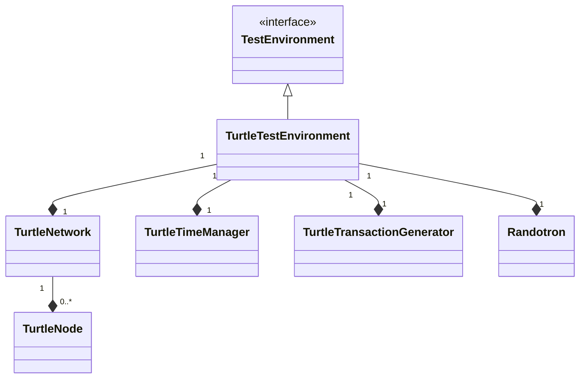
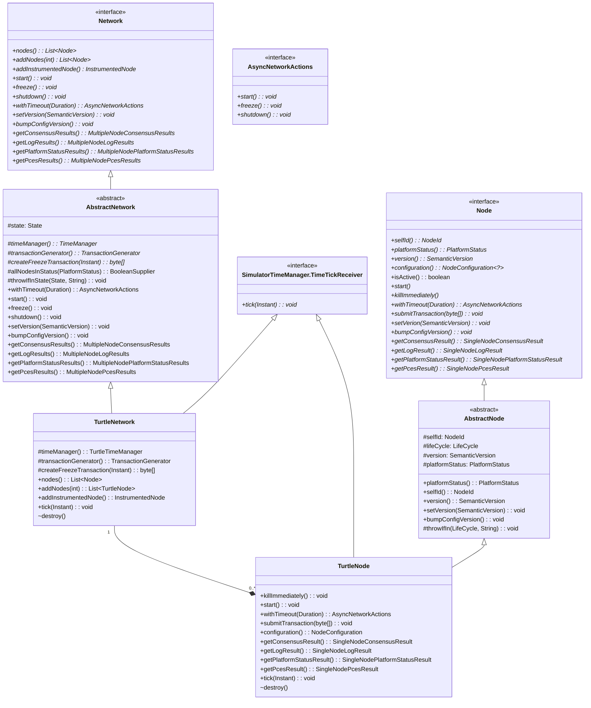
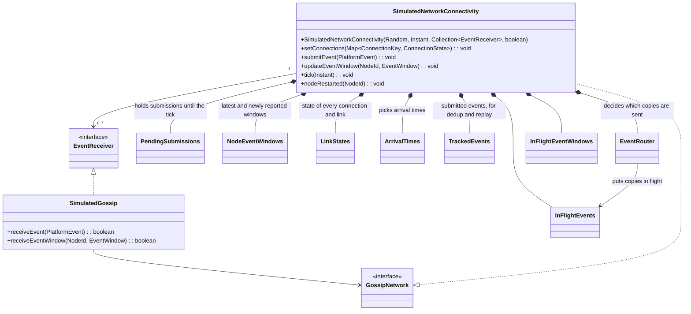
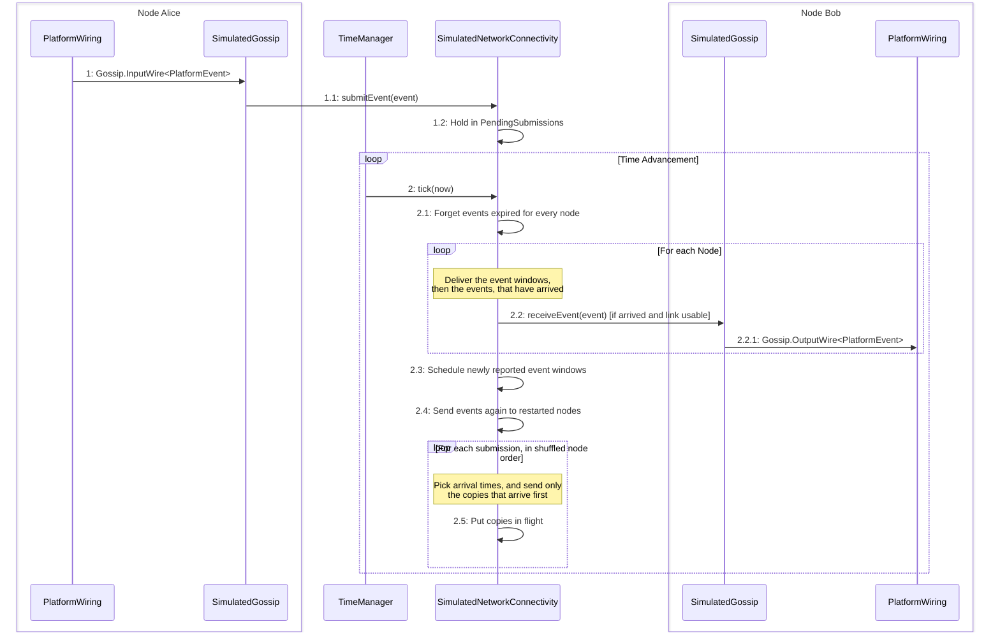
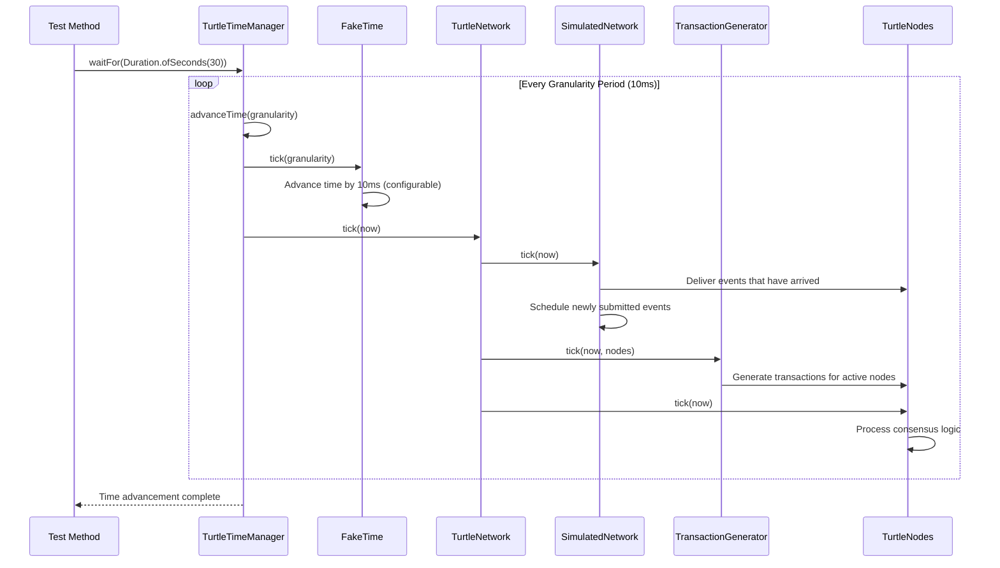

# 🐢 Turtle Environment Guide

Deep dive into the Turtle simulated testing environment for fast, deterministic consensus testing.

## Table of Contents

- [🎯 Overview](#-overview)
- [🏗️ Network and Node Management](#-network-and-node-management)
- [🌐 Network Simulation](#-network-simulation)
- [⏱️ Time Management](#-time-management)
- [🎲 Deterministic Testing](#-deterministic-testing)
- [📝 Per-Node Logging](#-per-node-logging)

## 🎯 Overview

The Turtle environment provides a **fast, simulated testing environment** that enables deterministic consensus testing without real network delays or Docker overhead. It's ideal for:

- **Development**: Fast iteration cycles during development
- **CI/CD**: Rapid test execution in build pipelines
- **Regression Testing**: Deterministic results for catching regressions
- **Algorithm Validation**: Testing consensus behavior under controlled conditions

### Turtle Environment Components

The following diagram illustrates the Turtle environment's core architecture:



The `TurtleTestEnvironment` is the main container that owns a single `TurtleNetwork`, `SimulatorTimeManager`, `TurtleTransactionGenerator`, and `Randotron`. The `TurtleNetwork` can contain zero or more `TurtleNode` instances. `TurtleTestEnvironment` manages all the core components needed to run deterministic consensus tests with multiple nodes in a simulated, single-JVM environment.

## 🏗️ Network and Node Management

The following diagram shows the key interfaces and classes for managing networks and nodes in the Turtle environment:



The `Network` interface and its abstract implementation `AbstractNetwork` provide the foundation for managing collections of consensus nodes, with `TurtleNetwork` being a specific implementation that uses simulated time and fake network delays for testing. The `Node` interface and its `AbstractNode` base class represent individual consensus participants, with `TurtleNode` being the concrete implementation that integrates with the simulated network environment.

## 🌐 Network Simulation

### Simulated Network

`TurtleNetwork` extends `SimulatedNetwork`, which owns a `SimulatedNetworkConnectivity`. Every `TurtleNode` gossips
through a `SimulatedGossip`, which hands the events and event windows of its node to the connectivity and receives what
the connectivity delivers to it. Falcon uses the same connectivity.

The connectivity does not run the production gossip protocol: no syncs are run and no messages are exchanged between
peers. Instead, it reproduces when production gossip would deliver each event:

- A node's own events are **broadcast** while the link is in broadcast mode, and arrive after the link latency plus
  jitter.
- Everything else arrives with the delay of a **sync**: the hold-back of `ancestorFilterThreshold` while broadcasting,
  the average wait for the next sync (one round trip plus half the pause between syncs), and the link latency.
- A link leaves broadcast mode while its round trip is above `disablePingThreshold`, and returns to it `pauseOnLag` after
  it falls below.
- A link that comes up waits out a **reconnect delay** of about five round trips before anything is delivered over it,
  and its two ends are sent each other's latest event window again.
- A copy that another node forwards is only sent if it **arrives first** at the receiver, before every copy already on
  its way. Receivers see each event at the same time as if every copy were sent, without most of the duplicates.
- When a link **goes down**, the events in flight on it are sent again by the node that has them and can deliver them
  soonest. If no such node has a link that is up, they are held until the link comes back.
- With **echoes**, a node is sent a forwarded copy of its own events once. Turtle turns echoes on, Falcon turns them off.

Nodes are identified internally by their rank, their position in node id order, and all per-node and per-connection
state is kept in arrays indexed by rank.

The nodes of a `SimulatedNetworkConnectivity` are fixed when it is created. The network creates it with every node when
it starts and discards it when it is shut down. Nodes reach it through `GossipNetwork`, which the network forwards to
the instance that is currently running.



### Default Network Configuration

Unless a test sets another topology, the network is a geographic mesh (`GeoMeshTopologyConfiguration.DEFAULT`): 20% of
the connections are within a region, 40% within a continent, and 40% intercontinental.

| Connection type  |  Latency  | Jitter |
|------------------|-----------|--------|
| Same region      | 5–30 ms   | 7.5%   |
| Same continent   | 30–80 ms  | 10.0%  |
| Intercontinental | 80–300 ms | 12.5%  |

### Event Transmission Flow

The following diagram shows how events flow through the simulated network:



The simulation of network communication happens in two steps:

#### Submitting an event

1\. When a node wants to submit an event, it is received by its `SimulatedGossip` instance via the appropriate `InputWire`.

1.1 `SimulatedGossip` sets itself as the sender of the event and calls `SimulatedNetworkConnectivity.submitEvent(event)`.

1.2 The event is held in `PendingSubmissions`, in the list of the submitting node. Nodes submit while they run
concurrently, so nothing is scheduled yet: scheduling draws random numbers, which has to happen in a reproducible order.

#### Delivering and transmitting events

2\. When the simulated time is advanced, `TurtleNetwork` calls `SimulatedNetworkConnectivity.tick(now)`.

2.1 The event window of the node that is furthest behind is applied, and the events expired for every node are
forgotten.

2.2 The event windows reported since the previous tick are put in flight to every other node.

2.3 Every event that is not expired is sent again to each node that has restarted since the previous tick, once, by the
node that has it and can deliver it soonest.

2.4 The submissions held since the previous tick are scheduled, one node at a time in a shuffled order, and within a node
in the order it submitted them. A node submitting an event again is ignored. For every other node, the copy is put in
flight if it is of use there: the creator's own copy always is, a forwarded copy only if it arrives first.

2.5 For each node, the event windows and then the events that have arrived over a usable link are delivered by calling
`receiveEventWindow` and `receiveEvent` on its `SimulatedGossip`. A node may refuse the events of a sender; they stay in
flight and are offered again on a later tick.

2.5.1 The `SimulatedGossip` instance forwards each event it accepts to its `OutputWire`, from which it is consumed by the
platform wiring.

The nodes run right after the network in every tick, at the same instant, so everything scheduled in steps 2.2 to 2.4
was sent at the time of the previous tick, and is scheduled with that time. It is scheduled before the delivery, so that
an event spends its latency in flight, rounded up to whole ticks, rather than one tick more. An event still spends at
least one tick in flight, because it was sent at the previous tick.

## ⏱️ Time Management

The Turtle environment's time management is central to its deterministic behavior:



This sequence shows how time advancement drives the entire simulation, ensuring deterministic execution. While code is running, time does not advance. When the test calls `waitFor()` or a related method on the `SimulatorTimeManager`, it advances time in fixed granularity steps (default 10ms) until the specified duration is reached. During each tick, the `SimulatedNetwork` processes events, the `TransactionGenerator` creates transactions submitting them to active nodes, and the nodes execute their consensus logic.

## 🎲 Deterministic Testing

### Randotron Usage

The Turtle environment uses `Randotron` for all randomization:

```java
final Randotron randotron = randomSeed == 0L
    ? Randotron.create()
    : Randotron.create(randomSeed);
```

The same `Randotron` instance is used throughout the test, ensuring that all random operations are consistent and reproducible. This is crucial for deterministic testing, where the same inputs should yield the same outputs across runs.

> [!NOTE]
> When `randomSeed = 0`, a truly random seed is generated for each test run.

### Reproducible Tests with Random Seeds

Use `@TurtleSpecs` to control randomness and ensure reproducible test results:

```java
@OtterTest
@TurtleSpecs(randomSeed = 42)
void testDeterministicBehavior(@NonNull final TestEnvironment env) throws InterruptedException {
    // This test will produce identical results every time
    final Network network = env.network();
    network.addNodes(4);
    network.start();

    env.timeManager().waitFor(Duration.ofSeconds(30));

    // Results will be identical across runs
    final long lastRound =
            network.newConsensusResults().results().getFirst().lastRoundNum();

    // This assertion will always pass with seed=42
    assertThat(lastRound).isEqualTo(69L);
}
```

## 📝 Per-Node Logging

All Turtle nodes share one JVM, so log routing depends on the `nodeId` stored in Log4j2's
`ThreadContext`. Enter node code paths inside a scope and let the helpers propagate the MDC:

```java
try (var scope = NodeLoggingContext.install(Long.toString(nodeId.id()))) {
    scheduler = NodeLoggingContext.wrap(Executors.newSingleThreadScheduledExecutor(
            new ContextAwareThreadFactory()));
    scheduler.schedule(NodeLoggingContext.wrap(() -> logger.info("tick")), 1, TimeUnit.SECONDS);
}
```

- Wrap every `ExecutorService` / `ScheduledExecutorService` with `NodeLoggingContext.wrap(...)`
  before handing it to platform components or `CompletableFuture`.
- When a framework forces the common fork-join pool, wrap the runnable/callable itself with
  `NodeLoggingContext.wrap(...)` so the captured context is restored on execution.
- Avoid direct `new Thread(...)`; if unavoidable, build it through `ContextAwareThreadFactory` to
  apply the snapshot automatically.

With propagation in place the routing appender emits `node-${ctx:nodeId}.log` files and the
`node-unknown` fallback remains empty during normal operation.

## 🔗 Related Documentation

|                        Guide                         |        Description        |
|------------------------------------------------------|---------------------------|
| [🏁 Getting Started](getting-started.md)             | Setup and your first test |
| [🏛️ Architecture](architecture.md)                  | Framework design overview |
| [✍️ Writing Tests](writing-tests.md)                 | Test development guide    |
| [🐢 Turtle Environment](turtle-environment.md)       | Simulated testing guide   |
| [🐳 Container Environment](container-environment.md) | Docker-based testing      |
